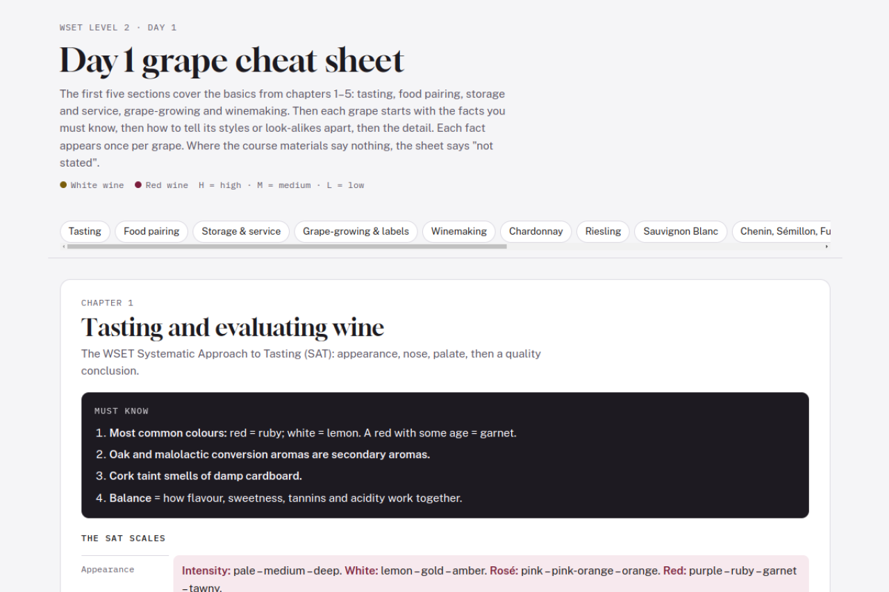
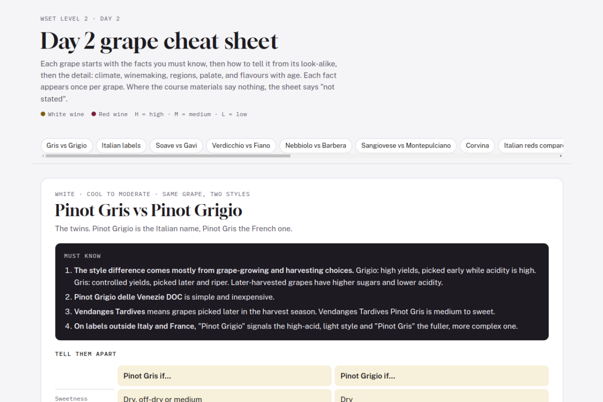
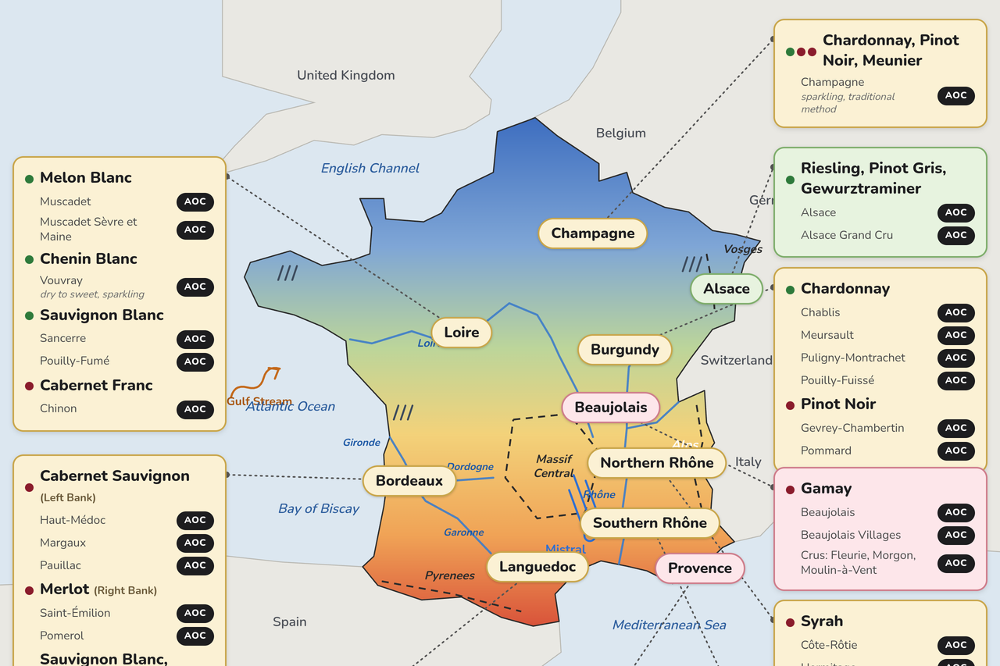
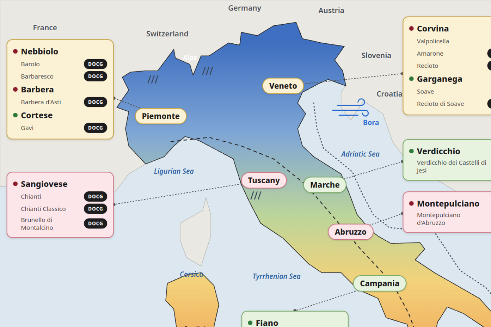
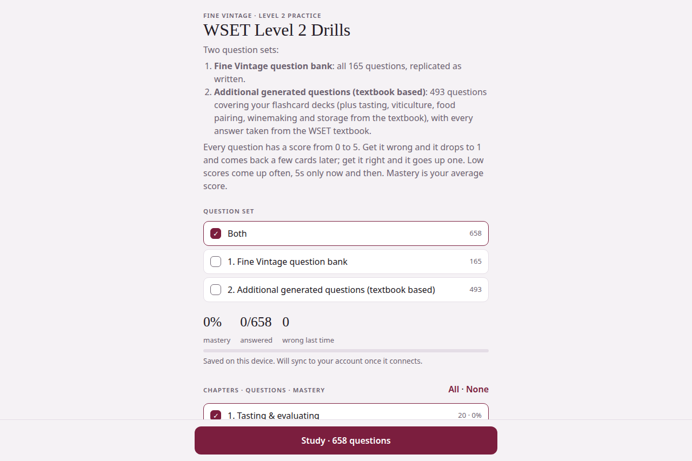
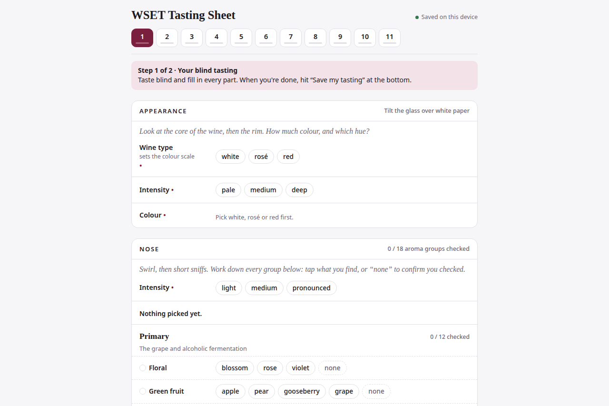

# 🍷 WSET Level 2 Study Materials

Study pack for the WSET Level 2 Award in Wines: grape cheat sheets, wine maps, a tasting sheet, and a question bank. Open the files in a browser, no app or install needed.

## Screenshots

### Day 1 cheat sheet

### Day 2 cheat sheet

### France wine map

### Italy wine map

### Question bank

### Tasting sheet

## What's inside

| File | What it is |
|---|---|
| `day-1-cheat-sheet.html` | Day 1 grape cheat sheet |
| `day-2-cheat-sheet.html` | Day 2 grape cheat sheet |
| `france-wine-map.html` | France wine map, WSET Level 2 |
| `italy-wine-map.html` | Italy wine map, WSET Level 2 |
| `question-bank.html` | WSET Level 2 drills and question bank |
| `tasting-sheet.html` | WSET tasting sheet |

## How to download

No GitHub account needed, no software to install.

1. Go to the green **Code** button at the top of this page.
2. Click **Download ZIP**.
3. Find the downloaded file in your Downloads folder and double-click it to unzip.
4. Open the folder and double-click any `.html` file. It opens in your browser, like a web page.
5. That is it. Save the folder somewhere you will find it again, for example your Desktop.

## How to use

- Start with the Day 1 and Day 2 cheat sheets to revise the grapes.
- Use the France and Italy maps to place the regions.
- Use the tasting sheet when you taste a wine, and the question bank to test yourself.
